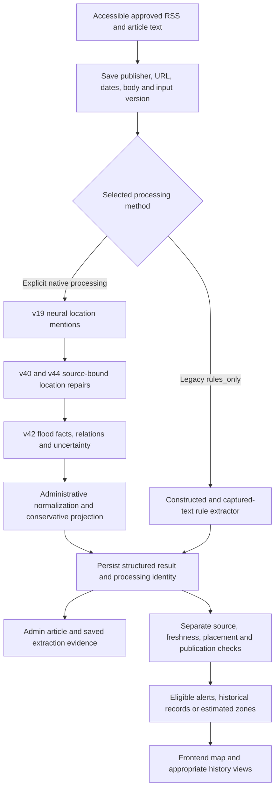

# SOP 1: presentation and demonstration guide

> Prepared October 25, 2026, Asia/Manila. Source checkout: `roi-branch`, commit `d328b382d41af1d27247174717c286e5eae7cd3f`. Read-only implementation analysis, three parallel investigators, fresh selected rule checks and Google Cloud inspection. No model training, holdout reevaluation, database mutation, deployment or paid model request was performed.

**SOP:** “How can neural Named Entity Recognition (NER) and supplementary rule-based processing identify and structure location references and flood-related context from accessible English and Taglish articles and evaluated constructed reports?”

## 1. The answer to explain first

**LANES turns article text into traceable place-and-flood records. A trained neural model finds location names; supplementary rules repair supported location mentions, identify flood facts and connect those facts to the relevant locations. The backend preserves the source wording and uncertainty, then saves structured results for inspection and separately controlled geographic presentation.**

The strongest demonstration is an article beside its saved extraction: show a place name, its learned label, its supporting passage and the flood facts attached to it. A colored map alone does not demonstrate NER.

### A presentation script, about three minutes

> “Our first SOP asks how we can turn English and Taglish flood reports into organized information that the system can use.
>
> An article is written as paragraphs. Our application needs separate fields: where the report refers to, what flood condition is described, how deep the water is, when it was observed and whether vehicles can pass.
>
> We use two parts. First, our trained neural Named Entity Recognition model identifies location names. It recognizes six categories: road, landmark, local area, barangay, city and province. It returns the exact words and their positions in the article.
>
> Second, supplementary rules interpret the flood context. These rules recognize English and Taglish expressions such as knee-deep and abot-tuhod, numeric depths, time expressions and vehicle restrictions. They also distinguish an actual flood report from a forecast, a statement saying there is no flood, or a report that water has subsided.
>
> Association matters. If an article mentions several roads, we should not attach every water level to every road. The rules use local sentences, clauses, headings and supported lists to connect evidence. When the text does not support a reliable connection, the information stays unresolved.
>
> Processing happens in our Python FastAPI backend. The database saves the captured article, its version, the processing method, the original NER locations, the rule repairs and the grouped facts. Our frontend displays these saved results with the source passage, so we can trace an extracted value back to the article.
>
> Recognizing a location is separate from putting it on a map. Administrative references help resolve place identity; road and spatial data support placement. Additional checks decide whether an observation can become a source alert or a geographic zone.
>
> For evaluation, our neural location model achieved 73.63 percent strict F1 on a frozen 60-passage research holdout, using AI-assisted silver references. We separately evaluated the supporting rule extractor on 50 constructed reports. These are different measurements, so we do not present the constructed result as the neural model’s accuracy.
>
> This addresses SOP 1 by showing a complete, inspectable path from accessible text to structured location and flood evidence, while preserving missing or ambiguous information.”

If asked about automation, add: **“The neural pipeline is implemented and has controlled cloud processing evidence. At our October 25 inspection, the ordinary news scheduler was paused, and the scheduled discovery code selects the older rules path. We demonstrate a saved native NER run and identify its processing method explicitly.”**

## 2. What is actually neural, and what uses rules?

| Part | Actual implementation | Simple explanation |
|---|---|---|
| Learned location recognition | Corrected `v19-control-seed-0`, selected step 945, spaCy 3.7.5 | Learns where location names begin/end and which location category they belong to |
| Pretrained initialization | Pinned `tl_calamancy_md` 0.1.0; transferred pretrained NER encoder/static vocabulary; fresh six-class head | Starts with learned language representations, then trains the LANES location categories |
| Neural architecture | Tok2Vec with hash embeddings/static vectors, MaxoutWindowEncoder and transition-based NER | A neural contextual encoder and entity recognizer; the retained recognizer is not a transformer or Gemini |
| Location repairs | v40 followed by v44 | Adds or corrects narrowly supported names, boundaries, road types and junction references |
| Flood-context extraction and association | v42 rules | Finds depth, time, status and access wording and connects it to supported targets |
| Shared adapter | v46 | Combines the location repairs and context processing; this is not a newly trained model |
| Durable method | `ner_rules_v1` | Records that this complete neural-plus-rules configuration processed the article |
| Separate legacy method | `rules_only` | Processes captured articles through the older rule extractor |
| Optional later resolution | Separately recorded Gemini-derived processing | Can produce evidence-linked corrections; it does not alter the original neural weights or original run |

The six learned labels are `ROAD`, `LANDMARK`, `LOCAL_AREA`, `BARANGAY`, `CITY`, `PROVINCE`. Depth, time, status and passability are **not learned NER classes in this retained model**.

Model loading and inference: [worker.py](../../backend/app/services/news_ner_runtime/worker.py). Model initialization: [experiment_registry.py](../../backend/training/flood_ner/experiment_registry.py). Layer composition: [location_pipeline.py](../../backend/app/services/news_ner/location_pipeline.py). Consolidated training evidence: [NER handoff](../guides/ner-groupmate-handoff.md).

## 3. Actual data flow



1. **Discover and capture.** Configured publisher domains and feeds are reviewed. English/Taglish flood terms shortlist candidates. The collector retrieves accessible article text and records failures. A headline/feed keyword is a lead, not proof of flooding. Access restrictions and missing article bodies limit coverage; this is not unrestricted internet understanding.
2. **Freeze the input.** Preserve the exact captured body, publication evidence, canonical URL and fingerprint. Different article versions can have different processing results. Publisher edits do not rewrite the original extraction input.
3. **Run the selected extraction.** Native processing loads authenticated model/tokenizer assets in an isolated Linux CPU subprocess. It emits exact text spans, labels and provenance. v40/v44 repairs preserve original neural mentions separately.
4. **Extract and relate context.** v42 recognizes measurements, body gauges, time expressions, flood states and vehicle restrictions. Local clauses, lists, headings and junction structure guide associations. Rivers described as causes, evacuation destinations and nearby facilities are not automatically flooded targets.
5. **Normalize conservatively.** Source-scoped administrative matching uses PSGC references. Ambiguous names are not resolved by taking the first catalog hit. Preserve raw depth alongside normalized fields. Explicit numeric evidence takes precedence over supported verbal gauges. Ranges, qualifiers, conflicting values and collective evidence remain traceable. Supported date/clock/timezone evidence is required for absolute timestamps.
6. **Save and inspect.** The structured result contains original mentions, effective mentions, proposals, abstentions, facts, relations, grouped observations, evidence offsets and unresolved facts. A calibrated confidence percentage is not invented; native projected confidence can be null.
7. **Evaluate and place separately.** Exact-source consistency checks test saved evidence against captured text. They are not independent field verification. OSM supports road identity and geometry; NOAH provides modeled susceptibility; Pasig historical evidence supports matching Pasig locations. These do not independently establish current flooding.
8. **Present eligible output.** Next.js/React displays backend results. MapLibre renders geographic output. Accepted active zones can inform a separate Valhalla routing path under policy. Restricted presentation outputs and historical evidence do not thereby become ordinary live routing input.

Source paths: [discovery](../../backend/app/services/news_discovery_service.py), [pipeline dispatch](../../backend/app/services/news_pipeline_service.py), [native processing](../../backend/app/services/news_ner_durable/processing.py), [context rules](../../backend/app/services/news_ner/context_association_v42.py), [locality resolution](../../backend/app/services/news_ner_durable/locality.py), [projection](../../backend/app/services/news_ner_durable/projection.py), [normalization](../../backend/app/services/news_ner_durable/fields.py), [source checks](../../backend/app/services/news_ner_durable/source_check.py).

## 4. Database: how the explanation stays traceable

| Storage | What it preserves | Presentation value |
|---|---|---|
| `news_articles` | Publisher, canonical URL, title/body, publication/fetch dates, retrieval errors, fingerprint | Where the text came from |
| `news_article_feed_entries` | Feed identity and raw JSONB metadata | How the article was discovered |
| `news_article_versions` | Immutable JSONB input snapshot and input fingerprint | Which exact article version was processed |
| `news_extraction_runs` | Mode, pipeline identity, processing status, attempts/errors, dates and JSONB result | Which method produced the saved output |
| Claim cases/sources/evaluations/decisions | Links from source/run evidence to evaluation and publication decisions | Why output was accepted, withheld or corrected |
| Flood events/reports/zones | Geographic and lifecycle records; spatial geometry uses PostGIS | Where an eligible observation is represented geographically |

Processing identity includes article version, pipeline and mode. Bounded attempts and owned worker leases support durable processing. Reader validation checks the result against its stored source/version rather than running NER again in the browser.

See [news models](../../backend/app/models/news.py), [processing CRUD](../../backend/app/crud/news_processing.py), [saved-result schema](../../backend/app/schemas/news_ner_result.py), [native readers](../../backend/app/services/news_ner_durable/readers.py), and [publication models](../../backend/app/models/news_publication.py).

These table descriptions were checked in source. This investigation did not query live table rows or assert current production row counts.

## 5. Demonstrate the existing application

Use an existing saved `ner_rules_v1` article. Prepare the article/run identifier during rehearsal. Existing records may also include `rules_only` results, so confirm the mode before calling it neural output. The authenticated screens below are source-verified; this investigation did not complete an authenticated live walkthrough.

| Step | Existing screen/control | What to say |
|---|---|---|
| 1 | `/admin/news` → News Intelligence → Sources & feeds / Collection status | “These are our configured article sources and saved collection results.” |
| 2 | Flooded Areas → search known article/location → Info | “This is a structured result from a captured source.” |
| 3 | Flood Details → What the article says | “The location, depth, condition, passability and time are connected to this supporting passage.” |
| 4 | Source Article → Processing history → View details | “This identifies the exact saved input and processing method.” |
| 5 | Mentions → Original NER locations | “These names and labels are the original learned-model output; the character positions point into the article.” |
| 6 | Rule-based location repairs | “These are separately recorded supplementary corrections, not new neural predictions.” |
| 7 | Grouped flood facts / Unassigned facts | “The rules connect facts to places and preserve facts they cannot confidently assign.” |
| 8 | Article and Technical tabs | “Here are the captured text, run identity, pipeline, attempts, dates and fingerprint.” |
| 9, optional | Inspect placement on map | “This is the next stage: locating the observation geographically. Previewing it does not publish a zone.” |

For an excluded/no-location/failed example, use **Collection status → All saved articles → View article → More details → View details**. This helps demonstrate appropriate rejection and uncertainty.

For an eligible retained historical event, use **`/admin/flood-history` → Flood Events → event → Overview → News sources → View captured article and extraction**. Keep the existing unified history view and normal filters. Restricted active presentation instances do not necessarily have a history counterpart.

Desktop displays article/history side by side; mobile uses Article/Processing history tabs. The evidence content remains available in both layouts. The transient NER preview endpoint is disabled by default and has local runtime restrictions; do not promise that every live admin screen can execute fresh NER on demand.

UI evidence: [NewsResultDialog](../../frontend/src/features/news/NewsResultDialog.tsx), [NativeExtractionEvidence](../../frontend/src/features/news/NativeExtractionEvidence.tsx), [NewsExtractionRecordView](../../frontend/src/features/news/NewsExtractionRecordView.tsx), [FloodEventDetailsTabs](../../frontend/src/features/flood-history/FloodEventDetailsTabs.tsx). Staff APIs enforce authenticated staff access; public readers expose eligible publication output separately.

### Demonstration materials to have ready

- One saved native article with visible original NER names and supporting flood evidence.
- One ambiguous/unassigned example, negation or forecast, to show why keyword matching is insufficient.
- The evaluation table below and this guide as a fallback if article access or authenticated UI fails.
- Your normal working presentation URL/session. The direct frontend `run.app` URL returned HTTP 403 in the fresh in-app browser used for this investigation; the actual access cause/custom-domain behavior was not investigated further.

Opening saved records is sufficient for this SOP. Fresh collection, paid correction, publication or cloud job execution is not required for the explanation.

## 6. Concrete examples with verified scope

### A. Taglish constructed report: actual rule-extractor output

Input from the existing 50-item fixture:

> Grabe ang flood sa Kapasigan, lagpas baywang na kaninang tanghali dahil sa walang tigil na ulan.

Selected fields from the freshly checked rule output:

```json
{
  "raw_place_name": "Kapasigan",
  "canonical_barangay": "Kapasigan",
  "depth_raw": "lagpas baywang",
  "depth_canonical": "waist",
  "condition": "active",
  "event_time_raw": "kaninang tanghali",
  "event_time_resolved": null,
  "flood_mentioned": true,
  "is_negated": false,
  "is_forecast": false
}
```

Explain: **“It keeps the source phrase and assigns a standard depth category. The relative time remains visible, but the missing calendar date is not invented.”** The qualifier `lagpas` remains in raw evidence; the waist category alone does not express the full qualifier or an exact measured depth. This example verifies the constructed rule extractor, not a new neural inference result.

### B. Negation

> Walang baha sa Barangay Kapitolyo at nananatiling passable sa lahat ng uri ng sasakyan.

Fresh rule output: Kapitolyo, `flood_mentioned=false`, `is_negated=true`, no depth, condition unknown. Explain: **“The word baha appears, but the sentence says there is no flood.”**

### C. Forecast

> Babala ng PAGASA: Posibleng bahain ang mababang lugar sa Santolan at Manggahan mamayang gabi.

Fresh rule output: separate Santolan/Manggahan claims, forecast true, flood-mentioned false, raw future time retained, absolute timestamp unresolved. Explain: **“A possible future flood is different from an observed flood.”**

### D. Association rather than spreading a depth across roads

> Sa Piña Street, 8 inches ang flood. Sa Áster Road, knee-deep ang flood.

The current v46/v42 rule chain, given supplied ROAD mentions, attaches `8 inches` to Piña Street and `knee-deep` to Áster Road, with active status and local scope for each. This was executed without neural inference. It demonstrates association logic; it does not claim the learned model recognized these fictional names.

Fixtures: [constructed reports](../../backend/tests/fixtures/taglish_flood_eval_set.json), [v42 scenarios](../../backend/training/flood_ner/context_cases_v42.py).

## 7. Results you can defend

### Neural location recognition

The retained corpus has **465 passages**, split **345 training / 60 validation / 60 research holdout**, with 1,021 reference location spans. They are not 465 independent articles or flood events. References are AI-assisted silver rather than independently human-verified gold.

| Partition | Precision | Recall | Strict typed-span micro F1 |
|---|---:|---:|---:|
| Training | 98.44% | 97.74% | 98.09% |
| Validation | 75.32% | 68.24% | 71.60% |
| Research holdout | 77.91% | 69.79% | **73.63%** |

Holdout: 60 passages, 96 reference spans, 67 true positives, 19 false positives and 29 false negatives. “Strict” requires both exact entity boundaries and the correct label. Precision describes how many predicted entities matched; recall describes how many reference entities were found; F1 balances both. These are entity-recognition results, not a percentage of articles fully understood or a measure of flood truth.

English holdout F1 is 74.47%; Taglish is 72.73%, with 30 passages each. Pure-Tagalog neural holdout performance was not separately measured. ROAD F1 is 66.67%; LANDMARK is 20.00% on seven references; LOCAL_AREA has zero holdout support. The model does not perform equally well on all classes. The large training/validation gap limits generalization claims.

### Constructed-report rule evaluation, freshly reproduced

The current evaluator processed 50 constructed inputs with 68 expected claims:

| Check | Result |
|---|---:|
| Flood / forecast / historical flags | 50/50 each |
| Negation flag | 48/50 |
| Expected barangay value found | 47/50 |
| Expected depth value found | 43/43 |
| Expected condition value found | 59/59 |

Barangay/depth/condition checks look for an expected value in **any** extracted claim, separately. They do not require all fields to be correct on one claim and do not penalize all extra predictions. Describe these as expected-value coverage, not complete record accuracy, neural F1 or geocoding accuracy. The evaluator does not measure timestamp accuracy.

Separately, all **36 current v42 constructed core scenarios passed** with supplied/cached location mentions. This checks rule behavior; it is not 100% neural accuracy.

The older **98.73%** figure comes from a separately dated constructed span result, 78 TP / 1 FP / 1 FN. The current 50-input evaluator does not reproduce that span score. Do not call it the current neural or overall system accuracy. Use its original scorer/reference/receipt if the paper retains it.

Runtime parity checks establish preservation/reproducibility of known outputs, not independent accuracy on new articles. No new holdout evaluation or model inference was performed for this guide.

Numeric normalization also has limits: the October 24 source audit reproduced canonical-gauge matches for 18/24 explicit numeric probes. Some rounded meter/centimeter reference values do not pass the parser's exact-gauge tolerance. Preserve the numeric source evidence and distinguish a missing canonical gauge from a missing source measurement; do not promise every numeric expression becomes a body-depth category.

Sources: [saved research metrics](../evaluations/flood-ner-v19-diagnosis-evaluation-20261018/holdout-aggregate.json), [training/data guide](../guides/ner-groupmate-handoff.md), [rule evaluator](../../backend/scripts/evaluate_taglish_extraction.py), [October 24 paper audit](chapter3-4-source-audit-20261024.md).

## 8. Google Cloud: what the fresh inspection establishes

See the sanitized [October 25 cloud receipt](../evaluations/sop1-system-audit-20261025/cloud-state.json) for the observation timestamp and selected metadata. Inspection used authenticated read-only `gcloud` descriptions and the public API health endpoint; credentials/full environments were omitted.

| Component | Fresh observation | How to explain its role |
|---|---|---|
| Project/region | `lanes-project-508809`, `asia-east1` | Hosting location |
| API | `lanes-api`; 100% traffic on `lanes-api-build-5eafeb0e-2bd9-4ae2-9380-656be548e5c8` at capture | Serves FastAPI and saved structured records |
| API health | Healthy; database connected | Confirms a connection, not extraction correctness |
| Frontend | `lanes-frontend`, serving revision recorded in receipt | Hosts the Next.js interface; direct browser URL returned 403 in this session |
| Database | Cloud SQL `lanes-db`, PostgreSQL 15, runnable; API Cloud SQL binding present | Stores application evidence and results; source defines PostGIS geometry |
| Ordinary discovery job | `lanes-news-discovery`, 1 CPU / 1 GiB; scheduled discovery CLI | Existing discovery/pipeline worker |
| News scheduler | `lanes-news-discovery-every-3-hours` is **PAUSED**; configured cron is every 15 minutes | Current cron state governs behavior; its old name is misleading |
| Separate neural/verification worker | `lanes-news-verified`, 1 CPU / 3 GiB; default command is `preflight` | Controlled processing resources; job existence does not prove continuous inference |
| Provider controls | API auditor `source_rules`; verified worker configured Gemini provider, but execution flag `0` | Configuration and actual allowed execution must be distinguished |
| History seed worker | Command replaced by a no-op exit | Not automatically importing new historical data |
| Zone expiry scheduler | Enabled every minute | Separate lifecycle maintenance |
| Valhalla | Separate Cloud Run service | Downstream route computation, outside the NER model |

The scheduler calls `run_news_pipeline` without a native context. That selects saved-article `rules_only` processing in current code. Native extraction needs explicit selection and narrowly authorized processing. Saved native reading and neural execution are separate capabilities. At this inspection, continuous automatic neural processing is not established.

For a brief Console explanation, show **Cloud Run → Services** for API/frontend/Valhalla, **Cloud Run → Jobs** for discovery versus verified worker, **Cloud Scheduler** for actual pause/cron state, and **Cloud SQL** for PostgreSQL. Do not expose environment secrets. Use the database/content evidence screen to explain NLP results; Console proves hosting configuration.

The root Cloud Build pipeline builds/tests the API image, runs migration gates and uses checked deployment/read compatibility before serving traffic. It deliberately does not execute RSS processing during an API release. The ordinary backend Dockerfile and dedicated NER worker packaging have different runtime purposes. See [cloudbuild.yaml](../../cloudbuild.yaml), [backend Dockerfile](../../backend/Dockerfile), and [inference worker](../../backend/app/services/news_ner_runtime/worker.py).

Fresh live database settings, table rows, extension version and authenticated admin display were not inspected. Dated cloud pilot receipts establish their own completed runs; they do not prove a service is presently processing continuously.

## 9. Likely panel questions

**Why combine NER and rules?** The learned recognizer identifies varied location names; explicit rules handle local flood expressions, context and evidence association. Each has a separate, inspectable role.

**Did you train an AI model or only write keywords?** A six-label neural location recognizer was trained from a pinned pretrained encoder. Supplementary deterministic rules handle contextual fields. Discovery keywords are an earlier shortlist, not the whole extraction system.

**Is Gemini the NER model?** No. The retained NER is the spaCy v19 location model. Optional Gemini processing is a separately identified derived stage, with the original result preserved.

**How does it handle Taglish?** Both English and Taglish passages are present in training and holdout data. Rules include bilingual flood, depth, time and access expressions. Holdout English/Taglish F1 is reported separately; untested wording can still fail.

**How do you avoid assigning one depth to every road?** Facts have source spans and target relationships; clauses, headings and supported shared groups constrain association. Unresolved or collective evidence is retained rather than converted into invented individual measurements.

**Can it locate a road by name alone?** Textual recognition gives a name/type. Administrative normalization and geographic matching are later steps; ambiguous identity remains unresolved.

**Does a detected place mean that it is flooded now?** No. Place mentions can occur in forecasts, negation, historical context or nearby-facility descriptions. Status, source time and publication eligibility are checked separately.

**What does 73.63% mean?** Strict F1 for location spans on the frozen 60-passage research holdout against silver references. It is not overall application accuracy or proof that all flood fields are correct.

**Why not claim 98.73%?** That belongs to a different dated constructed-input span experiment. It is not the neural holdout result. Our freshly reproduced 50-input rule coverage is reported separately.

**Does it understand every Filipino article?** The evaluated languages are English and Taglish, with limited samples. Pure-Tagalog neural performance is unmeasured. Accessible-source coverage and unseen names/phrasing remain limitations.

**Is the map a verified flood footprint?** It can be a source observation with separately qualified estimated placement. OSM/NOAH and a corridor margin are not measurements of actual wet width. Field-verified geometry is a separate provenance path.

**Is all of this automatic in production?** There is implemented automation and controlled neural processing. The current inspected scheduler is paused; its ordinary selected path is rules-only. Identify the saved neural run being demonstrated rather than claiming every article currently receives NER.

## 10. Verification boundary

Fresh checks for this preparation: current branch/clean baseline, source call-chain inspection, read-only cloud services/jobs/Scheduler/SQL metadata, public API/database health, one direct frontend-browser access attempt, the 50-input rule evaluator and 36 supplied-mention context scenarios. Saved neural metrics and model configuration were inspected without loading the trained model or touching holdout text.

No source code, database schema, operational configuration or cloud resources were changed. The only new repository artifacts are this presentation guide and the sanitized cloud-state receipt. No commit or push was performed.
