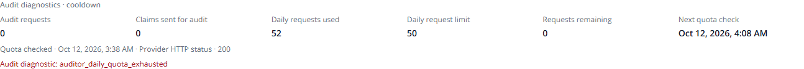
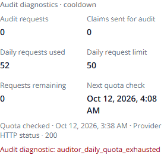

# Batch auditing and quota verification

> **Last Updated:** October 12, 2026, 9:09 PM by [@roicambe](https://github.com/roicambe) (Roi Cambe)
> **Developer:** [@roicambe](https://github.com/roicambe) (Roi Cambe)
> **Scope:** Local verification on `roi-branch`, followed by the developer's explicit documentation-update/Git-push request. Cloud release is separate. Engineering checks pass; real successful plotting/depth-update acceptance is unverified.

## Delivered behavior

**October 12 evening follow-up:** The developer requested a fresh September 24–25 replay followed by September 9. Provider allowance recovers to 50, and twenty real batch calls produce four independently verified text alerts. Original admission and footprint failures still result in zero zones/history; the 19-inch/10-inch pair expires after failed audits. The old 52/50/0 figures below describe the initial run. [Current retry, preview and limitations](../news-retry-20261012.md).

Eight locally eligible claims from the same saved extraction run/policy share one full-body audit request. Valid results complete separately by identifier/hash. Existing single-claim callers use the batch method. Response and prompt identity are versioned; previous terminal evaluations remain immutable. Backend/provider size limits, exact evidence binding, independent place/status/time/depth/access assessments and existing downstream activation requirements remain enforced.

OpenRouter preflight records only documented nonnegative request counters and safe HTTP diagnostics. Successful quota checks cache for 60 seconds. Zero free allowance defers without counting attempts; HTTP 429 stops the cycle. Quota/header cooldowns and original evidence deadlines survive restarts. Database advisory ownership serializes dispatch without holding transactions across network calls. The protected read-only automation status adds optional diagnostics inside the existing Overview details.

## Automated checks

| Check | Result |
|---|---|
| Broader offline extraction, discovery, auditor, admission, pipeline/CLI, results, publication/API, saved extraction and weather/status suites | 492 passed; four existing Linux-runtime warnings |
| Native PostgreSQL queue, controller, automation, public reads and publication lifecycle suites | 226 passed; four existing Linux-runtime warnings |
| Final focused auditor/batch/quota rerun after tightening typed request and safe HTTP diagnostics | 123 passed (overlaps broader suite; do not add to its total) |
| Final quota/status check including expired-cooldown display | 17 passed (overlaps earlier suites; one additional regression case) |
| Playwright `news-automation.spec.ts`, desktop Chromium and iPhone-13 viewport | 14 passed, including cooldown diagnostics, unknown counters, polling, failed refresh, weather details and tab/card behavior |
| TypeScript and scoped ESLint for changed news files/tests | Passed |
| Existing Alembic migrations on empty loopback databases | Head `d7e4b9a21c60`; definitions unchanged |

Native tests prove 26 eligible claims make exactly four initial requests (8/8/8/2), save 26 independent results and do not repeat when the same saved version is revisited. The same result holds with seven forecast claims preceding them; those complete locally with zero attempts. Zero quota defers all eligible rows with zero attempts. A real-client HTTP-429 fixture sends only its first eight claims, records safe diagnostics, leaves eighteen undispatched rows at zero attempts and prevents same-cycle dispatch. A cooldown alone does not wake the controller; original evidence-deadline maintenance still can. Existing token recovery/concurrent claim tests, no-lock-during-IO checks and native publication/clearance/expiry tests remain active.

Auditor fixtures cover shuffled, missing, duplicated, unknown and malformed candidates, wrong immutable hashes and cross-place evidence. Existing suites retain source headings, independent road measurements/passability, multiple barangays, clearances, conflicting updates, forecasts, negation, unavailable/expired facts, timeout, response/request bounds and transport/HTTP failures. Synthetic responses prove regression behavior only, not real flood plotting.

Windows Application Control blocked the installed native `psycopg_binary` DLL. Tests used the already present Linux backend image with pytest tools installed only in a disposable test runtime; repository dependencies are unchanged. Docker Desktop's stale runtime sockets were moved to dated local backups after stopping its processes; no database volume was removed/reset. Native writes were restricted to fresh guarded loopback test databases. Initial missing-file/fixture adapters and quota-cache regression failures were repaired and rerun; no failing tests were removed.

## Real historical scheduled replays

Additional native request-size tests inject a smaller transport bound to force pre-dispatch splitting, proving eight claims become four two-claim requests with exactly one attempt each. The same groups receiving HTTP 500 remain in bounded retry; they never fan out into per-location requests. Expired cooldown status is `awaiting_check`, rather than implying newly available quota.

Historical publisher responses use captured evidence/reconstructed RSS membership and the existing guarded replay clock. Only `run_scheduled_news_tick` performs domain processing/writes. Independent quota/provider access remains real and uses actual current UTC, not historical replay time. No source dates, measurements, labels, audit answers or publication/placement requirements are changed.

| Scenario | Fresh database | Observed outcome |
|---|---|---|
| September 9 indexed early body plus later captured updates | `lanes_workflow_20261012i` | 26 scheduled ticks; 3 articles, 4 immutable versions/runs, 77 per-claim evaluations, 33 final location cards; 0 zones, events or history locations |
| September 24–25 publication-time availability | `lanes_workflow_20261012j` | 5 ticks; 3 articles, 1 version/run, 11 evaluations, 5 location cards; original observations outside admission, 0 zones/events/history |

The actual OpenRouter quota GET returned HTTP 200 with **52 used / 50 limit / 0 remaining**. The September 9 worker persisted a 30-minute real-time cooldown and dispatched **zero audit requests/claims**, instead of wasting claim attempts. Collection and extraction continued; waiting claims aged into their original local expiry gates. September 24 required no audit dispatch because original observation admission failed locally. The private replay JSON files are retained under ignored `data/news-replay/` with the `-batch-audit-scheduled-workflow-20261012.json` suffix; earlier runs remain intact.

The saved depth comparison is **NS Amoranto near Banawe, Santo Domingo, Quezon City**: early GMA **19 inches at 08:55**, later Philstar **10 inches at 16:30**. Their separate claims and original source wording survive. Neither received real verification under exhausted quota, so no first zone existed and the update/create/reject branch of the zone service was never reached. Map/API/SQL history inspection returned zero records; it does not prove a successful depth refresh or a history bug. Deduplication and placement code were not changed.

Authentic historical RSS and the original early HTML remain unavailable; the indexed body has a reconstructed HTML wrapper. Publisher update availability, source hashes and earlier limitations are recorded in the [historical investigation](../news-scheduled-historical-workflow-20261012.md). Weather-controller dispatch is outside this replay; the ordinary unavailable-weather 30-minute collection policy runs unchanged.

## Separate local preview

Open [News Intelligence on port 3004](http://127.0.0.1:3004/admin/news). Its API is loopback port 8004 and database `lanes_workflow_20261012i`. The normal existing snapshot `lanes_plotting_20261011` and port-3000 development override remain untouched. Existing application startup supplies the local admin login (`admin` / `admin`); no flood rows are inserted to populate the preview.

Real authenticated browser inspection on desktop 1440×1000 and mobile 390×844 found 33 cards, zero active zones and an empty HTTP-200 Flood History list. The quota panel displays the saved 52/50/0 counters, zero dispatches and next quota check; both layouts fit their viewport. The completed historical worker uses historical cycle clocks while quota diagnostics use real time, so the existing Overview correctly shows collection overdue when viewed now.

| Desktop quota diagnostics | Mobile quota diagnostics |
|---|---|
|  |  |

Existing application labels/cards were preserved; only the approved optional diagnostics were added. Status GET does not call OpenRouter or start collection.

## Reproduction and review

Current checkout files, tests and [implementation plan](../../plans/news-batch-auditing.md) are reviewable without a deployment. The ignored Linux runner creates fresh `lanes_evaluation_test_*`, `lanes_settings_test_*` and `lanes_publication_lifecycle_test_*` databases and runs native pytest suites; it refuses to reuse normal/shared databases. Backend offline suites and normal frontend Playwright tests use existing project tooling. Credentials are passed through an ignored environment file and never recorded here or in committed diagnostics.

All eight core documentation records were audited. Task/progress, existing News Intelligence feature section, system/bug documentation and JSON storage/dependency audit notes are synchronized; no new architectural decision or SQL schema was introduced. Cloud release remains a separate matching API/worker/frontend rollout. Real provider recovery and positive map/depth/history acceptance remain open.

## Planner and publication audit

**October 12, 4:06 AM PHT — [@roicambe](https://github.com/roicambe) (Roi Cambe):** The developer subsequently requested a senior-planner update and push to `roi-branch`. Branch and Git identity are verified. Audit scope covers all eight core records: tech stack, task plan, progress, existing News Intelligence feature reference, architectural decisions, system documentation, database design and bug log. Decision history is preserved because this change does not introduce a major architectural pivot; existing JSON storage does not add SQL columns or models.

The plan/catalog and task/progress now separate completed engineering checks from pending real-provider plotting/depth/history acceptance. Source capture/heading fixes are included with the batch/quota implementation. Existing migration definitions and runtime dependency manifests are unchanged; fresh database upgrades reached `d7e4b9a21c60` during the recorded acceptance. Reuse those completed tests for this documentation-only continuation; no provider replay or application behavior change is necessary to publish the same verified implementation.

Private environment files, replay databases, captured publisher bodies, runtime helpers and temporary execution logs remain ignored. The saved **Start LANES Local Plotting** editor task requires this machine's ignored helper/configuration and existing snapshot; other checkouts use the existing **Start LANES Dev Server** task or the tracked replay scripts described in the guide. A Git push does not copy this private snapshot or release the API, worker or frontend to Google Cloud. Final publication checks cover document links, staged-file scope, whitespace, credential patterns and remote branch agreement.
