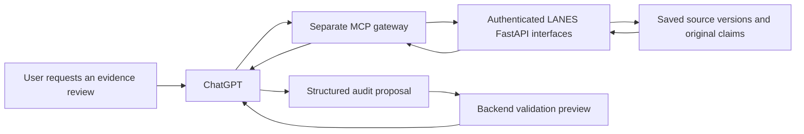

# Additive LANES MCP evidence-review pilot

> **Last Updated:** October 13, 2026, 12:57 PM by [@roicambe](https://github.com/roicambe) (Roi Cambe)
> **Owner:** [@roicambe](https://github.com/roicambe) (Roi Cambe)
> **State:** Original read/preview implementation disabled; clarified automatic auditing awaits local ChatGPT authorization and qualification.

## Current implementation and clarified objective

The original interactive pilot below was implemented locally with the developer-selected shared candidate dependency upgrade, not isolated dependencies. It remains disabled and unconnected. The developer subsequently clarified automatic news auditing as the intended outcome. A separate loopback ChatGPT plan sign-in helper is now tested and awaiting actual authorization; it does not activate the worker. Preserve all earlier pilot/provider work. Next gates are account/model eligibility, five bounded strict evidence tests, refresh and worker identity/recovery design, and supported hosting. [Current evaluation](../evaluations/chatgpt-plan-signin-20261013.md), [sign-in instructions](../guides/chatgpt-plan-local-signin.md). [@roicambe](https://github.com/roicambe) (Roi Cambe)

## Objective and preservation contract

Let an authenticated user review LANES's captured news and original extracted claims from ChatGPT using MCP. Preserve all existing OpenRouter/Gemini transports and configuration. This is an additional review path, not a provider replacement or an automatic publication shortcut. [Repository and official-doc findings](../research/lanes-mcp-chatgpt-feasibility-20261013.md).

No existing code is removed, moved or renamed. No branch is created; work remains on roi-branch. MCP starts disconnected/disabled, with no API-key generation call, no collection trigger and no automatic fallback. Current scheduled workers and public weather continue through their existing explicit configuration. No database change, dependency installation or deployment is part of this planning task.

The diagram is the proposed review flow; a verified dry run does not write an evaluation, publish an alert or modify routing. A separate optional persistence/publication stage is described below.

## Recommended library and environment

The follow-up comparison recommends **standalone FastMCP 4.1.0**, using qualified official **MCP SDK 2.3.0**, in a separate Python **3.12** gateway. Local Python 3.12.14 and the production 3.12 image already meet their interpreter requirements. No Python upgrade is needed for this recommendation. The same-environment resolver proves Pydantic and FastAPI/Starlette conflicts; an isolated dependency resolution succeeds without installation. [Comparison and measured resolver results](../research/lanes-mcp-library-selection-20261013.md).

Register a small explicit tool allowlist; do not bulk-convert all FastAPI routes or import the application's startup lifecycle into the gateway. FastMCP's OAuth helpers reduce protocol plumbing, while LANES account binding and capability enforcement remain required. The official Python SDK alone and official TypeScript v2 server are viable alternatives, but FastMCP is the recommended Python gateway framework. Build/lock/test the actual gateway runtime before claiming operational compatibility. Existing package pins remain untouched.

## Tools and scope

| Proposed tool | Purpose | Initial state |
| --- | --- | --- |
| `get_connection_status` | Identify the connected LANES account's permitted review capabilities and gateway version without secrets | Read-only |
| `list_saved_news` | Browse bounded saved article/run identities using existing protected reads | Read-only; do not label the location list a pending-audit queue |
| `get_claim_evidence` | Read an exact run/ordinal and its immutable source, hashes and relevant occurrence/parent context | Read-only |
| `get_audit_bundle` | Fetch up to eight original candidates from one article version, complete bounded body and exact indexed evidence options | Needs an additive backend bundle builder; read-only |
| `preview_audit_proposal` | Submit structured selections to backend validation without persistence or lifecycle effects | Later dry-run capability; no LLM call and no DB writes |
| `submit_audit_proposal` | Persist an authenticated proposal with idempotency/provenance | Not present in first version; requires separate write-stage qualification |

Tools return stable article-version/run/claim IDs, source URLs, immutable hashes, exact evidence quotes and explicit source/observation dates. Large bodies cannot be silently truncated while claiming complete review; return a bounded refusal or explicit pagination/completeness semantics. No free-text SQL, arbitrary URL fetch, credentials, user-supplied source substitution, clear-zone, delete-history or force-approve tools.

Use the existing schemas and `NewsClaimAuditor.batch_document` to form the backend-owned bundle. Keep gateway transformations limited to transport/presentation. Article text remains untrusted evidence; tool metadata/plugin instructions explain that it cannot override the user's task or source-validation rules. MCP host tool arguments still require strict backend validation.

## Phases and acceptance gates

### 0. Isolated transport proof

Use a separate FastMCP gateway runtime and dependency environment because current Pydantic and Starlette floors conflict with LANES pins. Propose any new folder/manifest before structural implementation; record dependencies in the appropriate repository manifests and qualify them without changing existing backend pins. Do not install FastMCP/MCP into the shared backend venv for this proof. An isolated pip resolution is already measured, but the target Linux image and actual imports/transport are untested.

Use synthetic or frozen local evidence, standard MCP tools and a bounded Streamable HTTP endpoint. Test MCP Inspector initialization/capability negotiation, schemas, invalid inputs, stable IDs, timeout/body limits and safe errors. Local stdio can test a compatible local host. No real private evidence on a publicly unauthenticated tunnel. No UI or database changes.

### 1. Authenticated saved-evidence reads

Choose an established MCP-compatible OAuth authorization provider and a reviewed LANES account-binding/delegation design. Publish protected-resource and issuer discovery, exact resource audience, allowed redirect URIs and PKCE support. Verify every tool's identity, scopes and LANES permissions; require reports=view/full through the existing capability policy, not merely any non-Commuter role. Backend delegation must resolve the real actor without exposing a broad shared staff bearer token or forwarding an incompatible OAuth token.

Enable only read-only saved-evidence tools against the dedicated local dataset first. Do not hold an evaluation lease while the user chats. Verify exact historical versions, repeated road names and negative/context-only claims: ordinary result browsing is filtered and cannot serve as the entire audit queue.

Expose the endpoint through an authenticated development HTTPS connection or eligible Secure MCP Tunnel. Connect it using ChatGPT's custom MCP/plugin workflow, inspect discovered tools, and test direct/indirect/follow-up and unsupported prompts. Record actual account availability; docs alone do not prove this account is connected. Refresh metadata and use a fresh chat after tool changes. [Connection procedure](https://developers.openai.com/plugins/deploy/connect-chatgpt).

### 2. Structured validation preview

Add a gated backend interface/service that reuses the original strict schema and existing evidence expansion/validation/classification. Preserve old provider request builders and parsing behavior. Compute source/claim/policy hashes server-side from saved immutable rows; reject changed input or an unsupported run before validating host selections.

Bind every proposal to candidate IDs, exact source version, extraction/policy/response revision and actor. Check duplicate/unknown/missing IDs, strict types/extra fields, excessive arrays, nonexistent indexes, cross-claim evidence, exact occurrence/parent locality, raw/canonical depth, observation time, contradiction/forecast/negation and size limits. Returned labels are never repaired to match candidates. Report per-claim dry-run reasons without silently accepting partial/truncated output. A preview may be marked readOnlyHint=true only if it truly writes nothing.

Use frozen Santo Domingo morning 19-inch and afternoon 10-inch sources, the original repeated-name eight-claim case, ambiguous title and synthetic forecast/negation. Preserve the morning half-knee wording versus saved knee-class discrepancy. Historical previews cannot become live alerts by resetting clocks or treating publication as flood onset. Original provider test budget is exhausted; MCP previews do not authorize new Gemini/Groq POSTs.

### 3. Optional durable review handoff

Only after read/preview acceptance, design a separate explicitly enabled unpublished review path. Existing `NewsClaimEvaluation` is unique per source/policy, uses 120-second owned leases and terminal immutability; it cannot be updated casually from a multi-minute chat. A draft/session must not claim the normal worker's lease. Re-read immutable inputs and current freshness/permissions at submission, then use a short owned transaction with idempotency and revision guards.

External-review provenance must identify the authenticated submitter and the actual review route. Model/version metadata stays unknown unless provided through trustworthy host telemetry; do not accept a model-written claim of model identity as proof. Never label a ChatGPT proposal OpenRouter or Gemini. Preserve completed evaluations and all prior policy identities/cooldowns. The existing publication loader compares current provider/model/prompt/response identity, so policy/admission changes require explicit design and tests rather than bypassing that check.

Prefer existing storage only if it supports the reviewed semantics; do not put an unbounded audit queue in SystemSetting JSON to avoid a migration. If storage/model changes are necessary, ask for the developer's required schema authorization before modifying SQLAlchemy/Alembic. Saving a proposal does not invoke staff correction or activate a zone. Publication/geometry/expiry gates and actor rules remain a separately qualified downstream handoff.

### 4. Release and rollback

Keep a gateway enable flag off by default, independently deploy/version the gateway if selected, and qualify exact serving endpoint/auth/protocol behavior with replicas/restarts. Cloud Run must not depend on a local in-memory session reaching the same instance; qualify legacy sessionless operation and the actual negotiated protocol. Feature/draft state and idempotency must survive appropriately or safely expire. Secrets use existing approved secret management, not repo/config logs.

Inspect desktop and mobile ChatGPT flows; if a LANES UI is later added, verify both application layouts under AGENTS.md. Recheck API/news/expiry images if backend interfaces are deployed through the existing Cloud Build path. Do not bundle an unqualified gateway into the current production build.

Rollback first disables/disconnects MCP; saved source/evaluation/history remains. Returning the worker to OpenRouter is an explicit configuration change after verifying its credential/model/account state, not an automatic switch that bypasses cooldowns. Weather stays separate until specifically qualified. Plus usage limits, hosting costs and future unattended plan-sharing eligibility remain distinct from this MCP pilot.

## Completion record

- [x] Read repository rules/design, applicable skills, docs catalog/core records and relevant pipeline/replay/research guides.
- [x] Review official MCP/OpenAI transport, tools, authentication, connection, SDK/dependency and plan-sharing guidance.
- [x] Trace existing read/validation/evaluation/publication boundaries and dependency/auth/lease gaps.
- [x] Produce this additive plan while preserving provider implementation and runtime configuration.
- [x] Compare standalone FastMCP/official Python/official TypeScript SDKs, measure same-environment conflicts and successful isolated resolution; recommend FastMCP 4.1.0 on existing Python 3.12 without installation.
- [x] Implement shared candidate dependencies, curated transport and strict previews; 64 MCP checks pass.
- [ ] Complete actual Google-protected MCP ChatGPT connection and Linux/PostGIS acceptance.
- [ ] Qualify strict dry-run proposals on original positive, ambiguous and negative evidence.
- [ ] Design and qualify any durable handoff, then separately assess publication/release.

No new runtime test or connection success is claimed by these checked research items. Existing 215 provider-validation tests belong to the preceding experiment and do not prove MCP behavior. The implementation placement/dependency manifest, OAuth account binding and later persistence policy are explicit decisions for the implementation stage.

## Current completion amendment

Real SIWC account authorization and model discovery succeeded. Three of five bounded requests used; the actual eight-claim result yields seven time reviews and a saved/source half-knee/knee disagreement. No qualified automatic auditor or MCP tool connection. [Live result](../evaluations/chatgpt-news-live-20261013.md), [MCP runtime/rollback](../guides/lanes-mcp-pilot-runtime.md). The original planning text above remains historical; shared upgrade was selected by the developer. [@roicambe](https://github.com/roicambe) (Roi Cambe)
